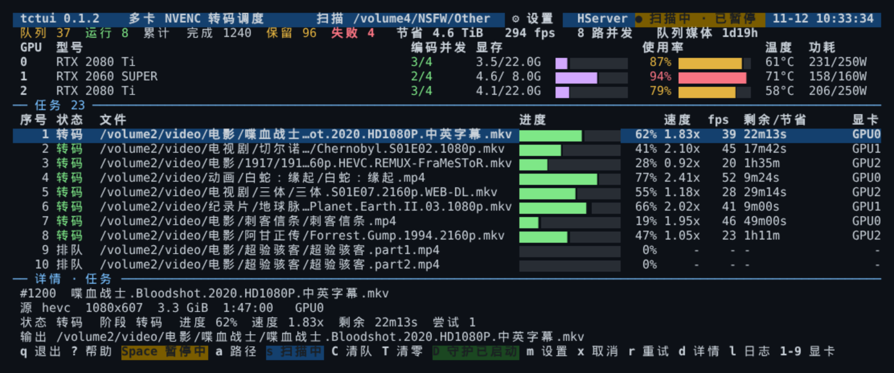
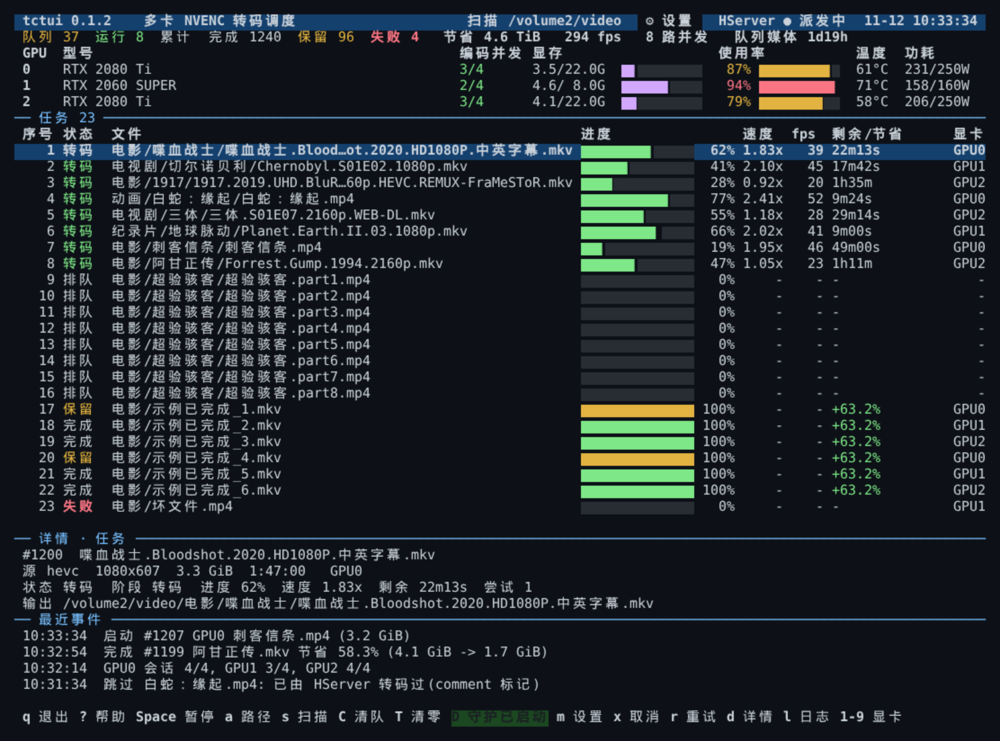
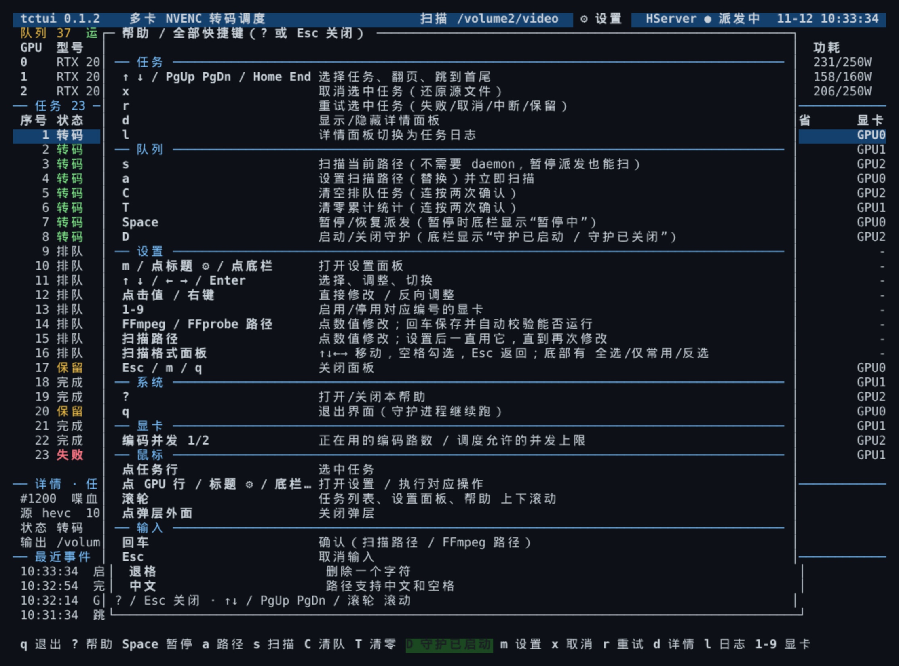
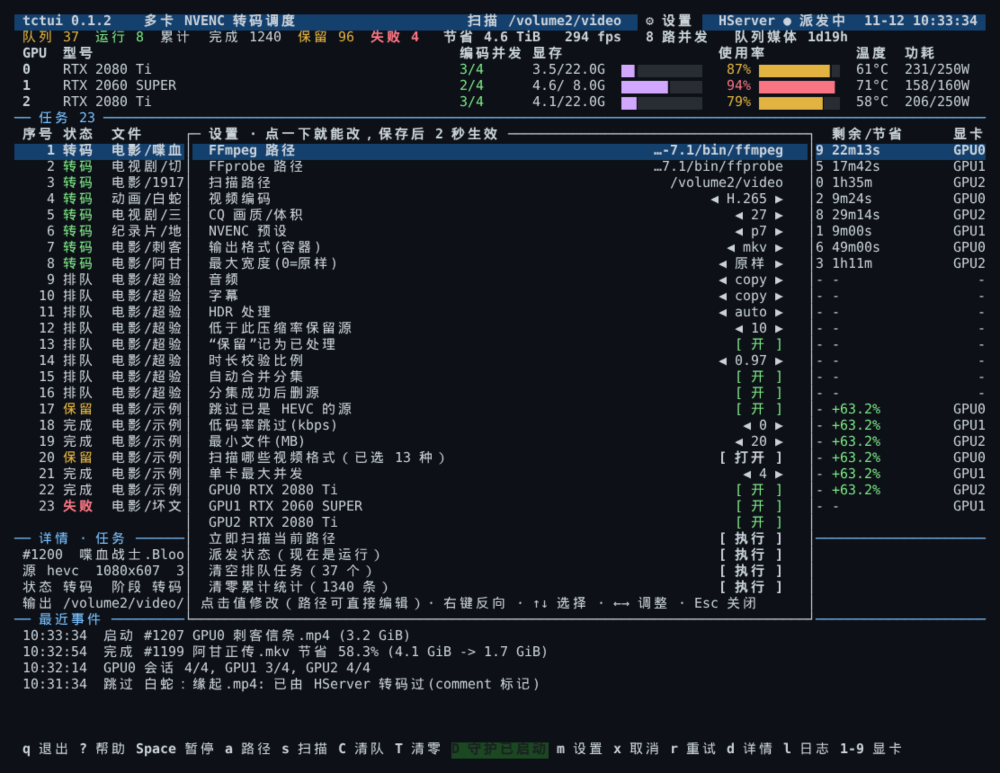
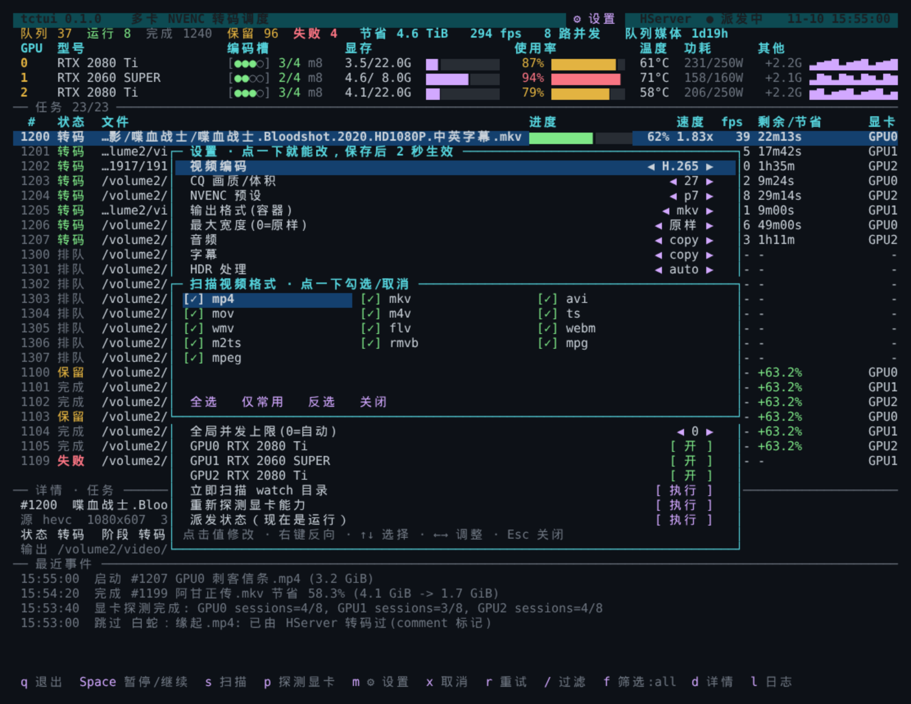

# tctui — 多卡 NVENC 转码调度器（nvtop 风格 TUI）

把 NAS 上的影视库批量转成 H.265，用多张 NVIDIA 卡并行，界面类似 `nvtop`：
上面是每张卡的编码会话 / 显存 / 利用率 / 温度 / 功耗 / 队列，下面是任务进度，
底部是选中任务的详情或日志。顶部的 `队列 / 运行 / 完成 / 保留 / 失败` 数字可以直接点击，跳到该类任务的第一个；
列表里的「序号」是任务创建时分配的稳定编号（跟着任务走，不是行号），任务完成后编号不变、位置会移到已完成区。

顶部会显示**当前扫描路径**和实时状态（扫描中 / 已暂停 / 守护未运行），
底栏在特殊状态下用底色提示：



设计上刻意分成两个独立进程，互不依赖：

```
        ┌────────────────────────┐         ┌──────────────────────┐
        │  tctui daemon          │  启动   │  worker (每任务一个) │
        │  扫描/入队/统计/分配   │ ──────► │  只负责调用 ffmpeg   │
        │  改名/删除/恢复/校验   │ ◄────── │  写 progress/result  │
        └───────────┬────────────┘         └──────────────────────┘
                    │ SQLite (WAL) + 心跳文件
        ┌───────────▼────────────┐
        │  tctui ui  (curses)    │  只读状态 + 发命令，不碰媒体文件
        └────────────────────────┘
```

* **daemon**：唯一允许改文件名的进程。负责队列、GPU 分配、任务完成后的
  压缩率判定、删除源文件、崩溃恢复。
* **worker**：纯执行器，只读入源文件、写临时输出，不删除任何源文件；
  `-nostdin -progress pipe:1`，把进度写成 JSON 给 daemon / UI 读取。
* **ui**：curses 界面，可以在 daemon 没启动时打开（会显示"守护未运行"）。

## 安装 / 快速开始

在源码目录直接运行（或先看下面的「安装」装成 `tctui` 命令）：

```bash
cd /path/to/tctui

./tctui doctor            # 环境自检：ffmpeg / 显卡 / 任务库 / 残留文件
./tctui                   # 打开 TUI
./tctui daemon --start    # 也可以命令行启动调度器（扫描 config.json 的 scan.path）
```

界面里从零开始：按 `a` 输入媒体目录 → 回车（设为扫描路径并开始扫描）→ 按 `D` 启动守护 → 自动开转。
第一次安装没有默认扫描路径；设置一次后会一直用它，直到你再按 `a` 改成别的目录。

## 安装（不打包）

程序是纯 Python 标准库，**不需要打包或编译**。可以从
[Releases](https://github.com/MeowPerth/TCTUI/releases/latest) 下载源码包，或直接用 git clone：

```bash
tar xzf tctui-0.1.2.tar.gz && cd tctui-0.1.2
# 或者 git clone https://github.com/MeowPerth/TCTUI.git && cd TCTUI
```

然后在解压/克隆出来的目录里执行一次：

```bash
sudo ./install.sh
# 可选：
#   --prefix /opt/tctui          程序装哪（默认 /opt/tctui）
#   --data   /var/lib/tctui      配置/队列/日志放哪（默认 /var/lib/tctui）
#   --bin    /usr/local/bin       tctui 命令放哪（默认 /usr/local/bin）
#   --data   /volume1/tctui      数据想放大的卷（推荐，尤其日志多时）
#   --migrate /volume1/docker/ffmpeg-tui   把旧的 config.json/state/logs 迁过来
```

装完直接：

```bash
tctui doctor
tctui                 # 打开界面
tctui daemon --start  # 或者界面里按 D
```

安装后的布局：

```
/opt/tctui/lib/tctui/          # 程序（只读即可）
/usr/local/bin/tctui           # 3 行 wrapper，设 TCTUI_HOME + PYTHONPATH
/usr/bin/tctui                 # 软链（sudo/root 的 PATH 里一定有 /usr/bin）
/var/lib/tctui/
├── config.json                # 设置
├── state/state.db             # 队列/历史
└── logs/{daemon.log,jobs/}    # 日志
```

* 升级：重新跑 `install.sh`，数据不动
* 卸载：`sudo ./install.sh --uninstall`（`--purge` 连数据一起删）
* 只要求 **Python 3.8+**；目标机没有 Python 时再用"自带运行时/单文件"方案
* 临时换数据目录：`TCTUI_HOME=/some/path tctui ...`
* Synology 上 `/opt`、`/var/lib` 都在根分区（本例 5.5G 可用），日志多的话建议 `--data /volume1/tctui`
不用另开终端，也不用先改配置文件。

第一次用建议先复制一份样本到 `testdata/` 里试（NAS 上已经有一套测试片），
确认无误再把 `config.json` 的 `scan.path` 指向真实媒体库。



上图为真实运行状态：11 个任务（8 路运行 + 3 排队），3 张卡各自的编码并发（正在用 / 调度上限）、
显存 / 利用率 / 温度 / 功耗，底部是选中任务详情与最近事件。

```bash
./tctui scan /volume1/docker/ffmpeg-tui/testdata   # 只入队，不启动界面
./tctui status                                     # 文本状态（适合 ssh 一行看）
./tctui pause / resume                             # 暂停/恢复派发（不打断运行中的任务）
./tctui retry 12 13                                # 重试指定任务
./tctui cancel 12                                  # 取消指定任务（自动还原源文件）
./tctui clear                                      # 清空排队（会问一次）
./tctui clear --yes                                # 不问，直接清空排队
./tctui clear --queued --mark-skipped --yes        # 清空且以后扫描不再入队
./tctui clear --finished --yes                     # 只清完成/失败记录
./tctui clear --all --yes                          # 排队 + 记录
./tctui logs 12                                    # 看某个任务的 ffmpeg 日志
./tctui config --set encode.cq=25                  # 改配置（daemon 2 秒内热加载）
./tctui daemon --stop
```

开机自启（DSM 任务计划，root 用户，开机触发）：

```bash
cd /volume1/docker/ffmpeg-tui && ./tctui daemon --start
```

也可以容器化运行，但需要 `--gpus all` 和把媒体目录、`/dev/nvidia*` 映射进去：
本版本默认直接跑在 DSM 主机上（Python 3.8 + 系统 nvidia-smi）。

> 同一个安装目录请**用同一个用户**运行（比如都用 root）。混用 root 和普通用户会让
> `state/state.db`、日志的属主不一致，启动时会给出明确的权限提示而不是一堆 traceback。

## 界面按键

| 键 | 作用 |
|----|------|
| `q` | 退出界面（守护进程继续跑） |
| `↑ ↓` / `PgUp PgDn` | 选择任务 |
| `Space` | 暂停/恢复**派发**（运行中的任务不中断）；暂停时底栏变黄显示「暂停中」 |
| `s` | 扫描当前路径，新任务入队；**在界面进程里执行，daemon 没启动或暂停派发都能扫**；扫描时底栏变蓝显示「扫描中」 |
| `a` | 设置扫描路径（替换旧的）并立即扫描，支持中文路径 |
| `D` | 启动 / **关闭**守护进程；底栏绿底显示「守护已启动」、红底显示「守护已关闭」，关闭时再按一次 D 确认 |
| `x` | 取消选中任务（SIGTERM worker，自动还原源文件） |
| `C` | 清空**排队**任务（按两次确认；运行中的不受影响，见下） |
| `T` | 清零累计统计（完成/保留/失败 + 节省，按两次确认；只清记录不动文件） |
| `r` | 重试选中任务（失败/取消/中断/保留都行） |
| `d` | 显示/隐藏详情面板 |
| `l` | 详情面板切换为日志 |
| `1`–`9` | 启用/停用对应编号的显卡（写入 config.json） |
| `m` | 打开设置面板（也可以直接点标题栏 `⚙ 设置` 或底栏 `m 设置`） |
| `?` | 帮助 |

### 累计统计怎么清零

顶部那排数字里，`队列`/`运行` 是实时的，`完成 / 保留 / 失败 / 节省` 是**从任务库累计**出来的，
不会自己归零。清零方式：

* 界面：按两次 `T`（第一次出现红字确认，第二次执行）；设置面板里也有「清零累计统计（N 条）」
* 命令行：`./tctui clear --finished --yes`
* 想连排队一起清：`./tctui clear --all --yes`

清零只删任务**记录**，不动任何视频文件；`processed`（已处理表）也不动，所以已经转好的文件
不会因为清零又被重新入队。唯一例外是失败/取消的任务：它们本来就没进 `processed`，
下次扫描还会重新出现（这也是方便你修好后重跑）。

### 清空队列

清空只是把 `queued` 的任务标记为取消，不会动文件；**正在转码的任务不受影响**
（要停单个任务用 `x`）。清掉的文件下次扫描（`s`/`a`/重启）还会重新入队。

* 界面：按两次 `C` 确认；设置面板里也有「清空排队任务」项
* 命令行：

```bash
./tctui clear                        # 清空排队，会问一次
./tctui clear --yes                  # 不问
./tctui clear --queued --mark-skipped --yes   # 清空且以后扫描不再自动入队
./tctui clear --finished --yes       # 只清 done/kept/failed/canceled 记录
./tctui clear --all --yes            # 排队 + 记录
```

`--mark-skipped` 会把清掉的文件写进 `processed` 表，之后扫描直接忽略；
如果哪天想重跑，用 `./tctui retry <id>`（还在列表里的话）或把它们移出扫描路径再放回。

底部会把**所有快捷键**列出来：宽屏一行，窄屏自动折成两行（最多三行），不会只显示一半。
`?` 打开完整帮助（带分组和说明，内容多时用 ↑↓/PgUp PgDn/滚轮 滚动，`Esc` 关闭）。



### 鼠标（设置面板）



点标题栏 `⚙ 设置`（或按 `m`）就能打开，点一下值就改：`◀ ▶` 步进、`[ 开 ]` 切换、
右键反向；改完立刻写 `config.json`，daemon 2 秒内热加载。

改**视频格式**有三个地方，都在面板里：

* `视频编码`：H.265 / H.264（显卡支持 AV1 时多一个 AV1）
* `输出格式(容器)`：mkv / mp4 / mov
* `扫描哪些视频格式`：点开是一个勾选面板，决定哪些扩展名会被扫描




界面支持鼠标（xterm/ncurses 的 SGR 鼠标模式，iTerm/Termius/Windows Terminal/SSH 都行）：

| 操作 | 效果 |
|---|---|
| 点任务行 | 选中该任务（详情面板跟着变） |
| 点 GPU 行 / 标题栏 `⚙ 设置` / 底栏 `m 设置` | 打开设置面板 |
| 滚轮 | 任务列表或设置面板上下滚动 |
| 点设置里的 `◀` / `▶` / `[ 开 ]` | 减 / 加 / 切换，**立刻保存 config.json**（daemon 2 秒内热加载） |
| 右键点设置值 | 反向调整（减） |
| 点面板外面 / `Esc` / `m` | 关闭设置面板 |

设置面板里可以直接改：视频编码、CQ、预设、输出容器、最大宽度、音频/字幕、HDR、
压缩率阈值、保留策略、时长校验、分集合并/删除、跳过 HEVC、低码率跳过、最小文件、
扫描哪些扩展名、单卡最大并发、三张卡的启用开关，以及"扫描 / 暂停派发"。

## 配置

配置文件：`/volume1/docker/ffmpeg-tui/config.json`（只写要覆盖的字段，其余用默认值）。

**每一项的含义、默认值、以及"拍板项"对应哪个 key，见 [CONFIG.md](CONFIG.md)。**
快捷方式：`./tctui config --where` / `--keys` / `--get KEY` / `--set KEY=VALUE`。

```json

```json
{
  "scan": {"path": "/volume2/video"},
  "scan": {
    "exts": ["mp4", "mkv", "avi", "mov", "flv", "wmv", "m4v", "ts", "m2ts", "rmvb", "webm"],
    "min_size_mb": 20,
    "skip_if_codec": ["hevc"],
    "skip_if_tagged": "Transcoded By HServer"
  },
  "series": {"enabled": true, "min_files": 2, "delete_sources_after_success": true},
  "encode": {
    "video_codec": "hevc_nvenc", "preset": "p7", "cq": 27, "out_ext": "mkv",
    "audio": "copy", "subs": "copy", "max_width": 0, "hdr": "auto",
    "fallback_software_decode": true, "fallback_to_cpu": false
  },
  "policy": {"keep_original_min_savings_pct": 10, "verify_min_duration_ratio": 0.97},
  "gpu": {
    "reserve_vram_mb": 1024, "min_free_vram_mb": 512,
    "max_parallel_per_gpu": 4,
    "prefer": "auto"
  }
}
```

改完不用重启 daemon：下一次派发/扫描就会读到新值（`gpu.max_parallel_per_gpu` 也是热加载）。

## 实测数据（NAS 上的 720p 老片）

用 3 分钟真实片段跑了一轮（cq27 / p7 / mkv）：

| 来源 | 结果 |
|------|------|
| 高码率 1080p / 4K 片源 | 通常省 40%–70% |
| 已经压过的 720p（约 1 Mbps） | 多数只有 -10%～+10%，被压缩率阈值拦下，保留原片 |
| 速度 | 3 分钟片段：单路 2.3x–5.8x，短片段最高 8–11x；三卡 8 路并发合计约 800 fps |

结论：低码率老片重压收益很小，可以把 `scan.skip_if_source_bitrate_kbps`
设为 1500 左右直接跳过（按 1080p 归一化），或者把 `encode.cq` 提到 30–32 换取更多体积收益。

## 目录结构

```
ffmpeg-tui/
├── tctui                    # 启动器 (sh)
├── lib/tctui/
│   ├── cli.py               # 子命令
│   ├── scheduler.py         # 调度守护进程（队列/分配/结算/恢复）
│   ├── worker.py            # ffmpeg 执行器（merge + transcode + 进度）
│   ├── gpu.py               # 显卡发现 / 分配算法
│   ├── scan.py              # 扫描、ffprobe、分集分组、命名
│   ├── db.py                # SQLite
│   └── ui.py                # curses 界面（含 --dump 无终端快照）
├── tests/                   # 单元测试：python3 -m unittest discover -s tests
├── state/                   # 任务库 state.db、采样/运行状态
└── logs/                    # daemon.log、jobs/<id>.log
```

## 并发上限（手动设置）

不再做显卡探测。每张卡用**同一个**手动上限：

```json
"gpu": {"max_parallel_per_gpu": 4}
```

或者界面里 `m` → 「单卡最大并发」直接调（1–8），保存后 2 秒热加载。

* 每张卡同时最多跑 N 个任务，`N` 就是 `max_parallel_per_gpu`
* 没有全局并发上限：总并发 = 启用卡数 × N
* 派发时仍会检查显存：剩余显存 ≥ 单任务预估 + `min_free_vram_mb`，
  挖矿/其他容器占了显存也不会把卡跑崩

**注意**：这台机器的 NVENC 会话上限是**整机共享**的（实测 12 路）。
总并发不要超过它，否则会随机报
`OpenEncodeSessionEx failed: incompatible client key (21)`。
三张卡的建议值是每卡 4（合计 12）；设 5 就是 15 路，会开始失败。

卡片面板里的 `编码并发 1/2` 读作：**正在用 1 路 / 手动上限 2 路**。

任务列表里的长文件名采用**中间省略**：保留开头的卷/目录和结尾的文件名，
例如 `/volume2/video/电影/喋血战士…ot.2020.HD1080P.中英字幕.mkv`。

## 任务状态

`queued → running → done / kept / failed / canceled / interrupted`

* `kept`：转码成功但压缩率低于阈值，或输出没有变小，已删除输出、保留源文件
  （阈值 `-1` = 关闭判断；`0` = 只要严格变小就替换；`10` = 至少省 10%）
* `interrupted`：worker 异常退出（kill -9 / 重启），源文件已自动还原
* `failed`：ffmpeg 失败或校验失败，源文件保留，可 `r` 重试

源文件安全：派发时先把源文件改名为 `.tctui-<id>.old.<ext>`，输出写
`.tctui-<id>.out.<ext>`，成功后原子 rename，失败/取消/崩溃时改名还原。
daemon 重启会自动结算所有"running 但 worker 已死"的任务。

## 测试

```bash
python3 -m unittest discover -s tests        # 21 个单元测试，无需显卡
./tctui ui --demo --dump --size 120x42       # 无终端预览界面
./tctui ui --demo                            # 用假数据看真实界面
```

## License

MIT，见 [LICENSE](LICENSE)。
